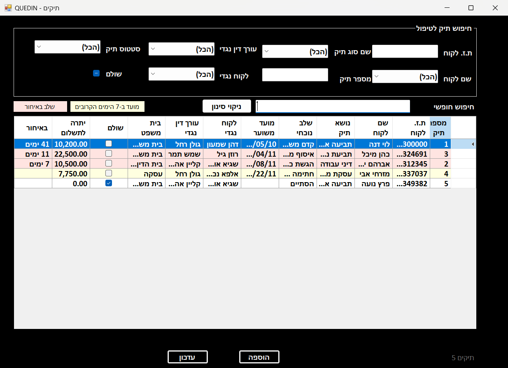
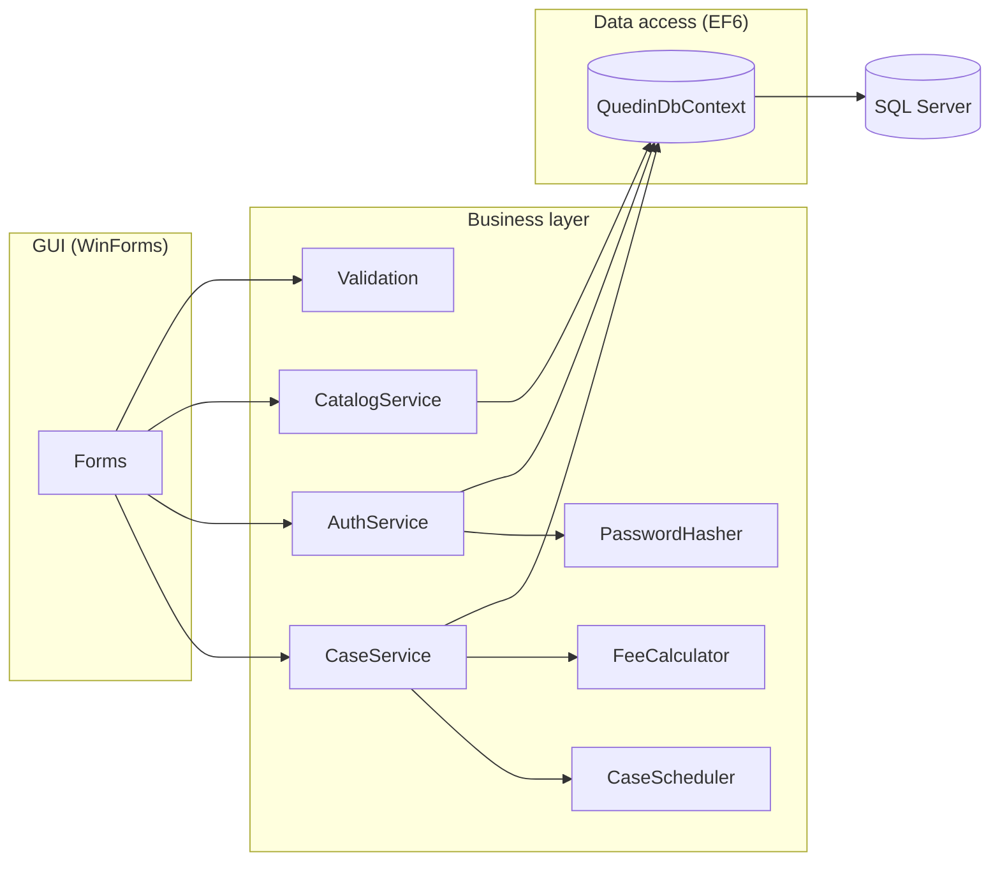
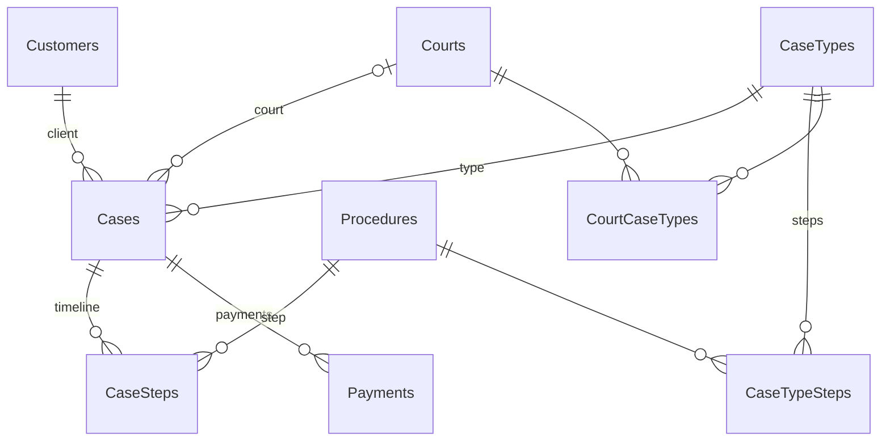

# QUEDIN

[](https://github.com/shirushit/quedin-law-office-manager/actions/workflows/build.yml)
[](https://github.com/shirushit/quedin-law-office-manager/releases/latest)
[](LICENSE)

Case, deadline and billing management for a small law office. Windows desktop application in
Hebrew (right-to-left), written in C# on .NET Framework 4.7.2 with WinForms, Entity Framework 6 and
SQL Server.

[עברית](#עברית)

## Contents

- [Overview](#overview)
- [Screenshots](#screenshots)
- [Quick start](#quick-start)
- [Building from source](#building-from-source)
- [Architecture](#architecture)
- [Scheduling rules](#scheduling-rules)
- [Data model](#data-model)
- [Security model](#security-model)
- [Deployment](#deployment)
- [Testing](#testing)
- [Repository layout](#repository-layout)
- [Known limitations](#known-limitations)
- [Background](#background)
- [License](#license)

## Overview

The application covers the daily work of the office:

- Clients, opposing parties and opposing counsel, identified by Israeli ID, company number or passport.
- Court cases (court, claim amount, award) and real-estate transactions (address, block and parcel).
- A timeline per case, built from the case type and recalculated as steps are completed.
- Fees, payments, credit notes, refunds and printed receipts with the VAT rate in force on the day.
- A home screen listing every open case whose next step is overdue or due within the week.
- Role-based access (manager, worker), user lockout and an append-only audit log.

Several workstations can share one database. Concurrent edits of the same case or customer are
detected with `rowversion` columns, and the second save is rejected instead of overwriting the first.

## Screenshots

All names, ID numbers and amounts are fictional.

| Home screen | Case: fees and timeline | Receipt |
|---|---|---|
|  |  |  |

| Cases | Case payments | Payments |
|---|---|---|
|  |  |  |

| Customers |
|---|
|  |

## Quick start

Prerequisites: Windows 10 or 11 and SQL Server Express LocalDB (installed with Visual Studio, or
separately from Microsoft).

1. Download `QUEDIN-<version>.zip` from the
   [latest release](https://github.com/shirushit/quedin-law-office-manager/releases/latest) and extract it.
2. Run `setup-demo.cmd`, or create the database manually and start the application:

   ```bat
   sqlcmd -S "(localdb)\MSSQLLocalDB" -I -i database\create-database.sql
   app\LawyerProject.exe
   ```

3. Sign in with one of the demo accounts:

   | User | Password | Role |
   |---|---|---|
   | `admin` | `Quedin2024` | Manager |
   | `worker` | `Worker2024` | Worker |

The script creates `QuedinDB` with demo data. Deadlines in the demo data are relative to the day the
script runs, so the home screen shows overdue and upcoming steps immediately.

The demo passwords are public. Change them, or create new accounts and deactivate the demo ones,
before entering real data.

## Building from source

Requirements: Visual Studio 2022 with the .NET desktop development workload.

```powershell
git clone https://github.com/shirushit/quedin-law-office-manager.git
cd quedin-law-office-manager
sqlcmd -S "(localdb)\MSSQLLocalDB" -I -i database\create-database.sql
```

Open `LawyerProject.sln` and run. NuGet restores Entity Framework on the first build. The connection
string is in `LawyerProject/App.config`.

The Entity Framework model, the entity classes and the database script are generated from a single
specification and must not be edited by hand:

| Generator | Output |
|---|---|
| [`tools/gen_model.py`](tools/gen_model.py) | `DB/QuedinModel.edmx` and the entity classes |
| [`tools/gen_sql.py`](tools/gen_sql.py) | `database/create-database.sql` |
| [`tools/gen_upgrade.py`](tools/gen_upgrade.py) | `database/upgrade-from-v1.3.sql` |
| [`tools/gen_csproj.py`](tools/gen_csproj.py) | the file list in `LawyerProject.csproj` |

## Architecture



- Forms collect input and display results. They contain no business rules.
- `CaseScheduler`, `FeeCalculator`, `Validation`, `PasswordHasher`, `LoginPolicy` and `Clock` have no
  dependency on the UI or the database and are covered by unit tests.
- `CaseService`, `AuthService` and `CatalogService` apply those rules to the Entity Framework model,
  check permissions and write the audit log. Multi-step saves run in one transaction; after a failed
  save, pending changes are discarded so that a retry cannot write them twice.
- The database enforces the rules that matter if someone bypasses the application: foreign keys,
  `CHECK` constraints, triggers and stored procedures (see [Security model](#security-model)).

Suggested reading order: [`CaseScheduler.cs`](LawyerProject/BLL/CaseScheduler.cs),
[`CaseSchedulerTests.cs`](tests/Quedin.Tests/CaseSchedulerTests.cs),
[`CaseService.cs`](LawyerProject/BLL/CaseService.cs),
[`AuthService.cs`](LawyerProject/BLL/AuthService.cs) and
[`create-database.sql`](database/create-database.sql).

## Scheduling rules

Each case type defines an ordered list of steps, and each step has a typical duration in days.
When a case is opened, its timeline is created from that list:

```text
Civil claim: Intake (7d), Collect evidence (14d), File claim (21d), Await defence (30d), ...
```

Completing a step on its actual date moves every later step by the same offset:

```text
Opened Mon 04/03            Step 1 completed late, 14/03    Step 1 completed early, 06/03
1. Intake       11/03       1. Intake       done 14/03      1. Intake       done 06/03
2. Evidence     25/03       2. Evidence     28/03 (+3)      2. Evidence     20/03 (-5)
3. File claim   15/04       3. File claim   18/04 (+3)      3. File claim   10/04 (-5)
```

- A due date never falls on Friday, Saturday, a Jewish holiday on which the courts are closed
  (computed with `System.Globalization.HebrewCalendar`) or a non-working day added by the office.
  It moves to the next working day.
- A date set by the court is fixed. Recalculation does not move it, later steps are counted from it,
  and the user is warned when an earlier step is now expected after it.
- Steps are completed in order and cannot be dated in the future or before the previous step.
  A manager can undo the last completion.
- Every step stores the duration it had when the case was opened, and every case stores the fees of
  its case type. Changing the catalogue later does not affect existing cases.

The rules are implemented in [`CaseScheduler`](LawyerProject/BLL/CaseScheduler.cs) and
[`FeeCalculator`](LawyerProject/BLL/FeeCalculator.cs). The fee of a case is the agreed percentage of
the claim or property value, not less than the case type's minimum fee, plus the court fee. The
balance is always computed from the payments and is never stored.

## Data model



| Table | Contents |
|---|---|
| `Customers` | Clients, opposing parties and opposing counsel |
| `Cases` | Court cases and transactions, with the fees in force when the case was opened |
| `CaseTypes`, `CaseTypeSteps` | Case types, their minimum and court fees, and their ordered steps |
| `Procedures` | Step catalogue with typical durations |
| `CaseSteps` | The timeline of a case: due date, completion date, fixed court dates, notes |
| `Payments` | Payments, credit notes and refunds, with the VAT rate of the day |
| `Courts`, `CourtCaseTypes` | Courts and the case types each court hears |
| `Users`, `AuditLog` | Accounts and the append-only audit log |
| `Settings`, `Holidays` | Office settings and additional non-working days |

## Security model

| Concern | Control |
|---|---|
| Password storage | PBKDF2-SHA256, 100,000 iterations, per-user salt. Plain-text passwords from the original version are re-hashed on first successful login. |
| Password guessing | Five consecutive failures lock the account for 15 minutes. Failures are counted in `usp_TryLogin` under `UPDLOCK, HOLDLOCK`, so concurrent attempts are counted correctly. `usp_ChangeOwnPassword` verifies the current password through the same procedure. |
| Account enumeration | An unknown user and a wrong password produce the same result and the same amount of work. A locked account is reported as locked and therefore reveals that it exists. |
| Direct database access | With [`security.sql`](database/security.sql) applied, workers have no access to `Users` and authenticate only through stored procedures running as owner. Workers cannot delete rows or change the catalogue. |
| Payment records | A trigger rejects changes to the amount, date or method of a recorded payment, including by the owner. A payment can be marked cancelled only when its credit note exists. |
| Audit trail | `AuditLog` is append-only (trigger and `DENY`). Each row records the database login that wrote it (`DbLogin`, set by a default constraint). |
| Card data | Only the last four digits of a card are stored. |
| Input errors | Amounts are limited to 1,000,000,000, dates to 20 years ahead, and the database checks amounts, percentages and references with `CHECK` and foreign-key constraints. |

The CI pipeline connects to SQL Server 2022 as a member of `QuedinWorker` and verifies that each
forbidden operation fails with the expected error.

## Deployment

| Task | Procedure |
|---|---|
| Office details | Sign in as a manager and open the office settings screen (`הגדרות משרד`). Name, address, tax ID and VAT rate are stored in the database and shared by all workstations. The setup guide (`מדריך הקמה`) lists the remaining configuration. |
| Database permissions | Run `database/security.sql` and add each employee's Windows login to `QuedinWorker` or `QuedinManager`. Run it again after recreating the database. |
| Upgrading from v1.3 | Run `database/upgrade-from-v1.3.sql`, then `security.sql`. The upgrade runs in one transaction, keeps all data and can be run more than once. Do not run `create-database.sql` on a database that holds real data; it recreates the database. |
| Backups | Managers can back up from the home screen and are reminded when the last backup is older than one day. For a scheduled backup use `database/backup-nightly.cmd`; restore instructions are in the file. |
| Workstation clock | "Today" is read from the database server. The application warns at sign-in when the local clock differs by five minutes or more. |

## Testing

| Suite | Scope | Environment |
|---|---|---|
| [`tests/Quedin.Tests`](tests/Quedin.Tests), 134 tests | Scheduling (weekends, holidays, fixed dates, rescheduling, undo), fee, VAT, balance and refund calculations, lockout policy, password hashing, input validation | Any platform: `dotnet test tests/Quedin.Tests` |
| [`tests/Quedin.IntegrationTests`](tests/Quedin.IntegrationTests), 39 tests | The data layer against a real `QuedinDB`: authentication procedures, lockout, retries after failed saves, immutability of payments, concurrency, catalogue permissions, audit log. Each test runs in a transaction that is rolled back. | Windows with LocalDB |
| CI database job | Creates the database on SQL Server 2022, upgrades a v1.3 database and checks its data, applies `security.sql` and runs the permission checks as a worker | Every push |

Every push builds the application and runs both test suites on Windows. The release archive is
built only after all jobs succeed.

## Repository layout

```text
LawyerProject/
  BLL/            business rules and services
  DB/             Entity Framework model and entity classes (generated)
  GUI/            WinForms screens
database/         create-database.sql, upgrade-from-v1.3.sql, security.sql, backup-nightly.cmd
tools/            code generators for the model, the SQL scripts and the project file
packaging/        files included in the release archive
tests/            unit tests (.NET 8) and integration tests (.NET Framework, LocalDB)
docs/             screenshots and the original design diagrams
```

## Known limitations

- Windows only. The application targets .NET Framework 4.7.2.
- Holidays with a variable civil date, such as Independence Day, are not calculated and must be added
  in the office settings.
- With `security.sql` applied, workers can still insert payment rows directly through SQL. Such rows
  pass the database constraints but not the application's balance checks, and they are not written to
  the audit log by the application. `DbLogin` identifies who inserted them.
- The integration tests require LocalDB and therefore run only on Windows.
- No e-mail reminders and no document storage.

## Background

QUEDIN was my high-school final project in 2024, developed for a working law office. The first commit
of this repository is the original submission. Later versions are a review and rewrite of that code:
the defects were fixed, business rules were moved into a tested layer, the schema and code were
renamed to English, and two independent code reviews were addressed. [CHANGELOG.md](CHANGELOG.md)
lists the changes in each version.

The original design diagrams are in [`docs/use-case.png`](docs/use-case.png) and
[`docs/context-diagram.png`](docs/context-diagram.png).

## License

[MIT](LICENSE). Copyright Shira Toledano.

---

<div dir="rtl">

## עברית

QUEDIN היא מערכת לניהול משרד עורכי דין: לקוחות וצדדים שכנגד, תיקים בבית משפט ועסקאות נדל"ן,
שכר טרחה, תשלומים, קבלות וקבלות זיכוי.

לכל תיק נבנה לוח שלבים לפי סוג התיק. כשמסמנים שלב כבוצע, מועדי השלבים הבאים מחושבים מחדש.
מועד לא נקבע ביום שישי, בשבת, בחג שבו בתי המשפט סגורים או ביום שהמשרד הגדיר כיום לא עבודה.
מועד שנקבע על ידי בית המשפט נשאר קבוע.

הפרויקט נכתב כפרויקט גמר בתיכון ב-2024 עבור משרד עורכי דין פעיל, ועבר מאז סקירה ושכתוב מלאים.
פירוט השינויים נמצא ב-[CHANGELOG.md](CHANGELOG.md).

**הרצה:** מורידים את קובץ ה-zip מהגרסה האחרונה ומריצים את `setup-demo.cmd`.
משתמש הדגמה: `admin` עם הסיסמה `Quedin2024`. יש להחליף את סיסמאות ההדגמה לפני עבודה עם נתונים אמיתיים.

</div>
