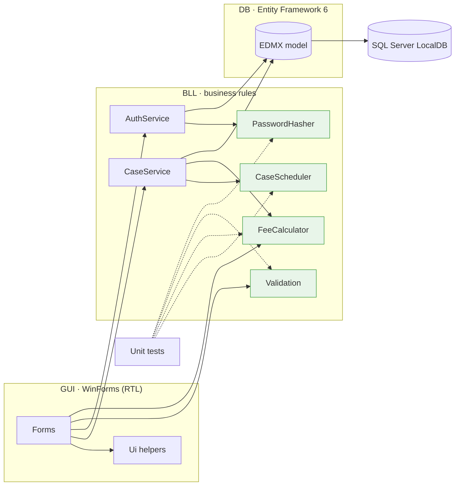
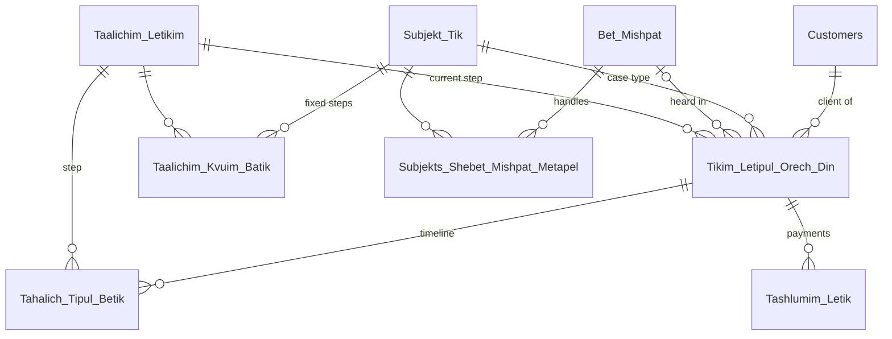
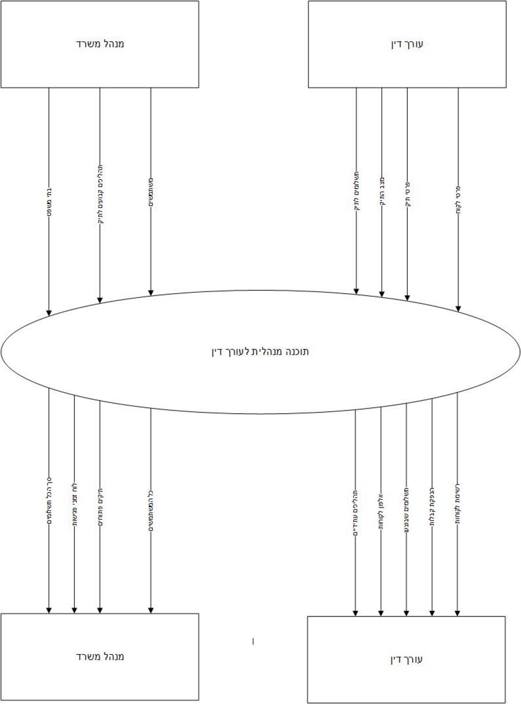

<div align="center">

# QUEDIN ⚖️
### Case & deadline management for a law office

[](https://github.com/shirushit/quedin-law-office-manager/actions/workflows/build.yml)

-blue)


**English** · [עברית](#עברית)

</div>

QUEDIN is a Hebrew desktop application that runs the day-to-day work of a law office:
clients and opposing parties, court cases and property deals, fees and payments, receipts —
and, at its core, **a timeline engine that plans every case and keeps its deadlines up to date**.

It started as my high-school final project (2024), built with a real law office as the client.
**v1.1** is a full review and refactor of that project: I fixed the bugs, secured the data,
extracted the business rules into a tested layer and made the project runnable from a clean clone.
See [CHANGELOG.md](CHANGELOG.md) for everything that changed.

---

## ✨ Features

| | |
|---|---|
| 📅 **Automatic case timeline** | Opening a case creates its steps from the case type (e.g. *filing → defence → pre-trial → evidence → ruling*), each with an estimated date. |
| 🔁 **Deadlines that move** | Completing a step early or late pushes the dates of every later step. Steps cannot be skipped. |
| 🚦 **Deadline radar** | The cases list puts open cases with the nearest deadline first: late steps in red, steps due within 7 days in yellow. |
| 💰 **Fees, balances, receipts** | Fee = agreed % of the claim (or property value) + court fee. Every payment updates the balance and produces a printable receipt with an 18% VAT breakdown. |
| 🏛️ **Court cases & property deals** | Court, claim and award amounts for litigation; address and land-registry numbers (gush/chelka) for real-estate deals. |
| 👥 **Roles** | Managers configure courts, case types, processes and users; regular users work on clients, cases and payments. |
| 🔒 **Security** | Salted PBKDF2-SHA256 password hashes; card payments keep only the last 4 digits. |

## 🧠 How the timeline engine works

Each case type has an ordered list of fixed steps, and each step has a typical duration:

```text
Civil claim:   1. Intake meeting (7d) → 2. Collect evidence (14d) → 3. File claim (21d) → 4. Await defence (30d) → ...
```

```text
Case opened on 01/03          Step 1 done LATE on 12/03           Step 1 done EARLY on 03/03
1. Intake        08/03        1. Intake        ✔ 12/03            1. Intake        ✔ 03/03
2. Evidence      22/03        2. Evidence        26/03  (+4d)     2. Evidence        17/03  (−5d)
3. File claim    12/04        3. File claim      16/04  (+4d)     3. File claim      07/04  (−5d)
```

The rule lives in [`CaseScheduler`](LawyerProject/BLL/CaseScheduler.cs): a pure class with no UI or
database access, covered by [unit tests](tests/Quedin.Tests/CaseSchedulerTests.cs).
[`CaseService`](LawyerProject/BLL/CaseService.cs) maps it to the Entity Framework model.

## 🏗️ Architecture



Green classes are pure and unit-tested; the forms only collect input and show results.

## 🗃️ Data model



| Table | Meaning |
|---|---|
| `Customers` | Clients, opposing parties and opposing lawyers (`SugPerson`) |
| `Tikim_Letipul_Orech_Din` | Cases (court cases and property deals) |
| `Subjekt_Tik` | Case types, with fee and court fee |
| `Taalichim_Letikim` | Catalogue of processes and their typical duration |
| `Taalichim_Kvuim_Batik` | Ordered fixed steps of each case type |
| `Tahalich_Tipul_Betik` | The timeline of a specific case (estimated / done dates) |
| `Tashlumim_Letik` | Payments and the balance after each one |
| `Bet_Mishpat`, `Subjekts_Shebet_Mishpat_Metapel` | Courts and the case types each one handles |
| `Users` | Users, roles and password hashes |

## 🚀 Getting started

**Requirements:** Windows · Visual Studio 2022 with the *.NET desktop development* workload
(it includes SQL Server Express LocalDB).

```powershell
git clone https://github.com/shirushit/quedin-law-office-manager.git
cd quedin-law-office-manager

# create the database with demo data
sqlcmd -S "(localdb)\MSSQLLocalDB" -i database\create-database.sql
```

Then open `LawyerProject.sln` and press **F5** (NuGet restores Entity Framework automatically).

| User | Password | Role |
|---|---|---|
| `admin` | `Quedin2024` | Manager |
| `worker` | `Worker2024` | Regular user |

> No `sqlcmd`? In Visual Studio open **View → SQL Server Object Explorer**, connect to
> `(localdb)\MSSQLLocalDB`, open `database/create-database.sql` and run it.

The demo data is fictional. Its deadlines are relative to the day you run the script,
so some steps show as late and some as due soon right away.

## 🧪 Tests

```powershell
dotnet test tests/Quedin.Tests
```

57 tests cover the timeline engine, fee/VAT calculations, password hashing and input validation
(Israeli ID check digit, phone numbers, e-mail, dates). CI builds the app and runs the tests on
every push.

## 📁 Project structure

```text
LawyerProject/
├── BLL/          business rules (CaseScheduler, FeeCalculator, Validation, PasswordHasher, services)
├── DB/           Entity Framework 6 model (EDMX) and entity partial classes
├── GUI/          WinForms screens (Hebrew, right-to-left)
└── App.config    connection string, VAT rate, "due soon" window
database/         create-database.sql: schema + demo data
tests/            MSTest unit tests (.NET 8)
docs/             diagrams from the original project book
```

## 📐 Original design documents

| Use case | Context diagram |
|---|---|
|  |  |

## 🗺️ Roadmap

- **v2.0:** ASP.NET Core Web API + React, EF Core migrations, JWT roles, Docker Compose
- English naming across the domain model (`Case`, `Client`, `Payment`, …)
- Deadline reminders by e-mail
- Document attachments per case

---

<div dir="rtl">

## עברית

**QUEDIN** היא מערכת לניהול משרד עורכי דין: לקוחות, תיקים בבית משפט ועסקאות נכסים, שכר טרחה, תשלומים וקבלות.
הלב שלה הוא **מנוע תזמון** שבונה לכל תיק את רשימת השלבים לפי נושא התיק, ומעדכן אוטומטית את המועדים של כל השלבים הבאים כשמסמנים שלב כבוצע.

הפרויקט נכתב כפרויקט גמר בתיכון (2024) עבור משרד עורכי דין אמיתי.
גרסה 1.1 היא בדיקה ושכתוב של הפרויקט: תיקון באגים, אבטחת סיסמאות ונתוני תשלום, שכבת לוגיקה נפרדת עם בדיקות יחידה, וסקריפט שמקים את מסד הנתונים עם נתוני דמה.

**הרצה:** להריץ את `database/create-database.sql`, לפתוח את `LawyerProject.sln` ב-Visual Studio 2022 וללחוץ F5.
כניסה עם `admin` / `Quedin2024`.

</div>

---

Built by **Shira Toledano** · [github.com/shirushit](https://github.com/shirushit) · Licensed under the [MIT License](LICENSE)
