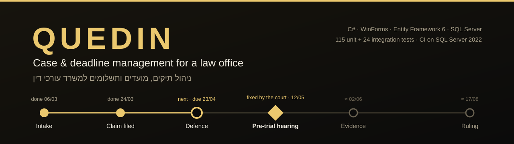
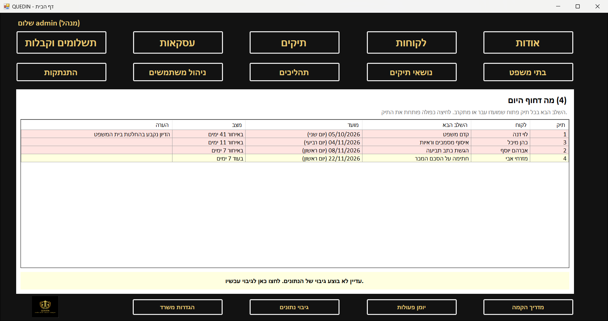
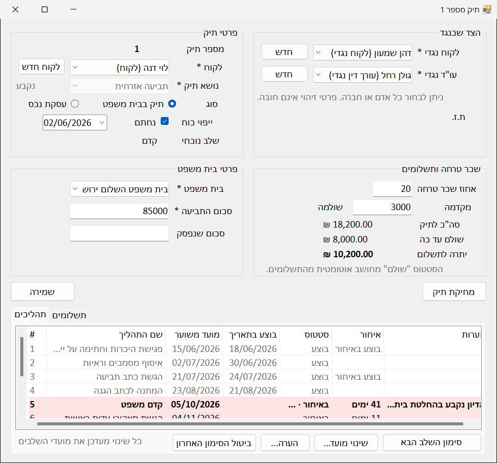
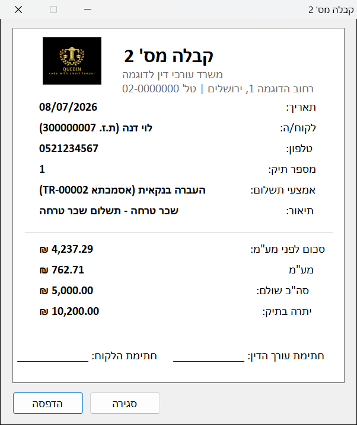
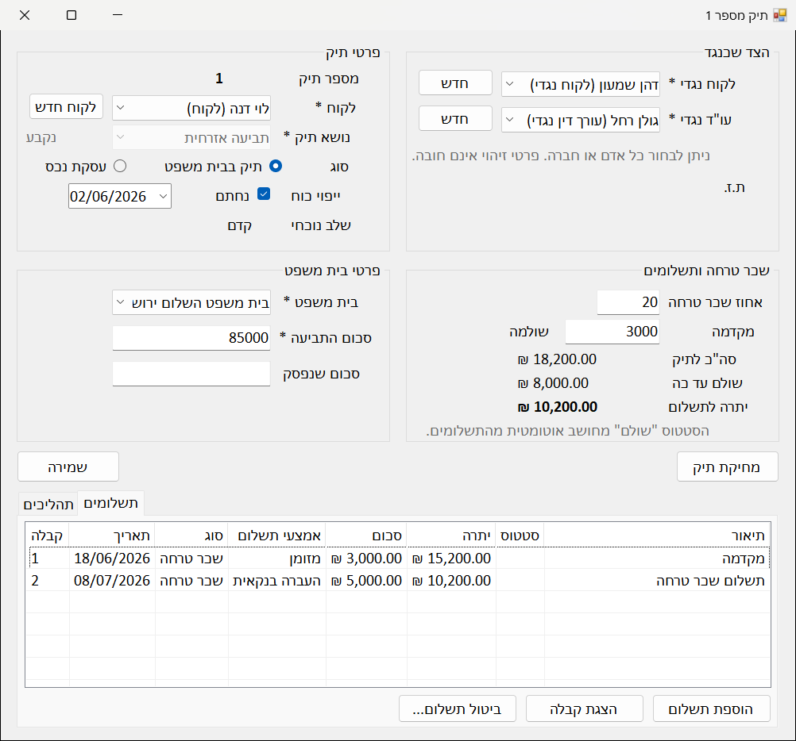
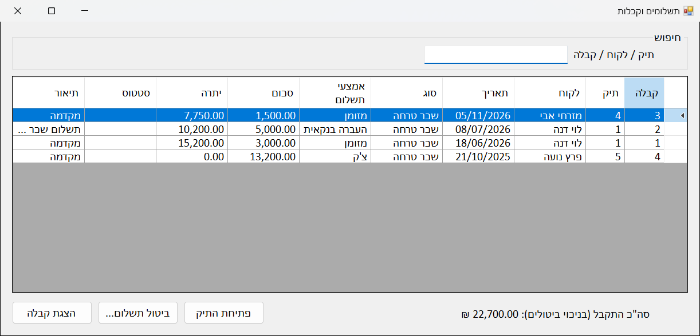
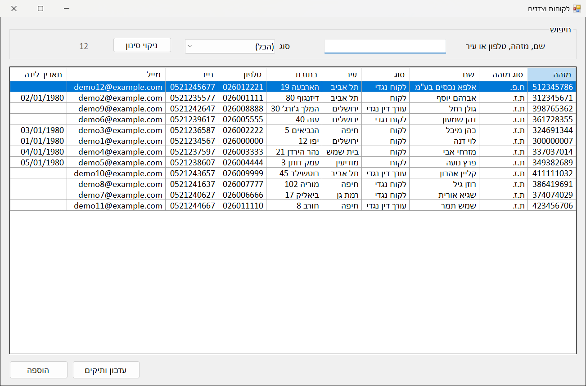
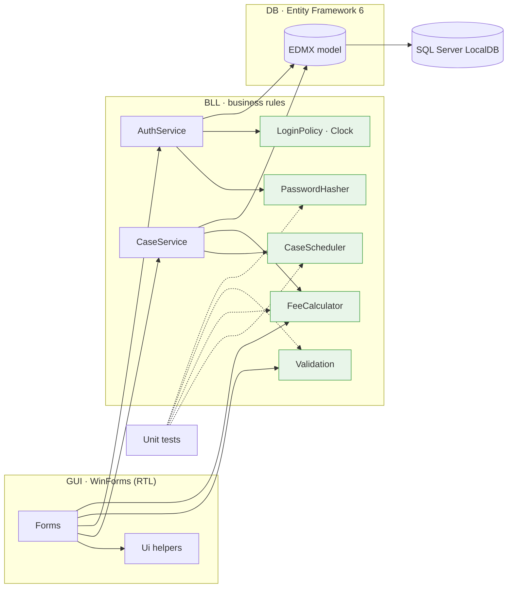
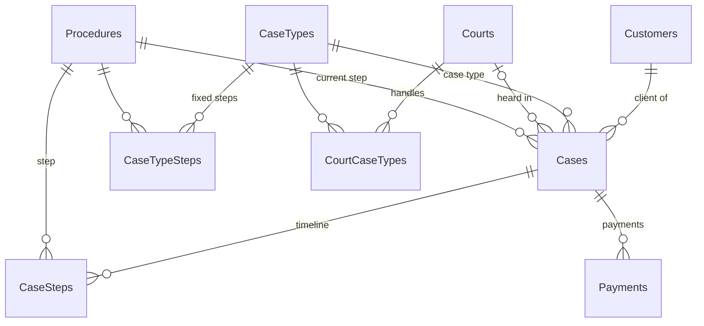
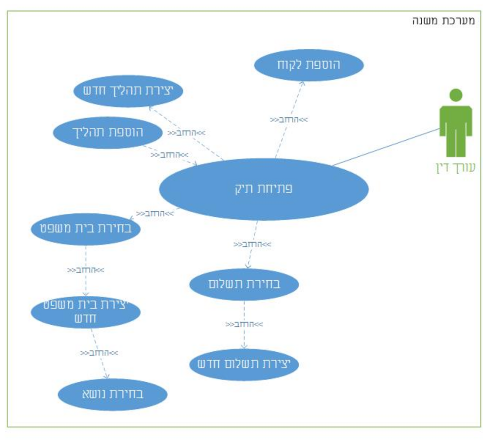

<div align="center">



[](https://github.com/shirushit/quedin-law-office-manager/actions/workflows/build.yml)

-blue)


**English** · [עברית](#עברית)

[Screenshots](#-screenshots) · [Features](#-features) · [Timeline engine](#-how-the-timeline-engine-works) · [Where to look](#-where-to-look-in-the-code) · [Architecture](#%EF%B8%8F-architecture) · [Getting started](#-getting-started) · [Tests](#-tests)

</div>

QUEDIN is a Hebrew desktop application that runs the day-to-day work of a law office:
clients and opposing parties, court cases and property deals, fees and payments, receipts —
and, at its core, **a timeline engine that plans every case and keeps its deadlines up to date**.

It started as my high-school final project (2024), built with a real law office as the client.
**v1.1** is a full review and refactor of that project: I fixed the bugs, secured the data,
extracted the business rules into a tested layer and made the project runnable from a clean clone.
**v1.2** fixes everything found in a usability test and an edge-case code review: a "what's urgent
today" home screen, court-set dates, payment cancellation by credit note, an audit log, optimistic
concurrency and strict money parsing. **v1.3** renames the whole code base and database to English
and closes every edge case from a second review (two users on one case, holidays, refunds, lockout,
server time). **v1.3.1** fixes the findings of an independent code review: password checks moved into the
database, recorded payments cannot be edited, a failed save leaves nothing behind, plus screen polish.
See [CHANGELOG.md](CHANGELOG.md) for everything that changed.

## 📸 Screenshots

The app is in Hebrew (right-to-left). All names, IDs and amounts are fictional demo data.

| Home: what's urgent today | A case, its fees and its timeline | Receipt |
|---|---|---|
|  |  |  |

| All cases, late and due-soon highlighted | A case's payments | Payments and receipts |
|---|---|---|
|  |  |  |

| Customers and other parties |
|---|
|  |

## 🔎 Where to look in the code

Five minutes with the project? These files show the most:

| File | Why it is interesting |
|---|---|
| [`BLL/CaseScheduler.cs`](LawyerProject/BLL/CaseScheduler.cs) | The timeline engine: plans a case, pushes deadlines, keeps court-set dates fixed, skips weekends and Jewish holidays (computed with `HebrewCalendar`). Pure code, no UI or database. |
| [`tests/Quedin.Tests/CaseSchedulerTests.cs`](tests/Quedin.Tests/CaseSchedulerTests.cs) | The rules above written as tests, including the edge cases found in review. |
| [`BLL/CaseService.cs`](LawyerProject/BLL/CaseService.cs) | Where the rules meet Entity Framework: computed balances, payments cancelled by a reversing entry, optimistic concurrency with `rowversion`, audit log. |
| [`BLL/AuthService.cs`](LawyerProject/BLL/AuthService.cs) · [`PasswordHasher.cs`](LawyerProject/BLL/PasswordHasher.cs) | PBKDF2 hashes, upgrade of the original plain-text passwords on first login, lockout after repeated failures. |
| [`database/create-database.sql`](database/create-database.sql) · [`.github/workflows/build.yml`](.github/workflows/build.yml) | Reproducible database with fictional demo data, verified on a real SQL Server 2022 in CI. |
| [`CHANGELOG.md`](CHANGELOG.md) | How a 2024 high-school project was reviewed, fixed and hardened, step by step. The original code is the first commit. |

---

## ✨ Features

| | |
|---|---|
| 📅 **Automatic case timeline** | Opening a case creates its steps from the case type (e.g. *filing → defence → pre-trial → evidence → ruling*), each with an estimated date. |
| 🔁 **Deadlines that move** | Completing a step (on the real date) pushes every later step. A date set by the court is kept fixed and later steps count from it. The app never sets a deadline on a weekend or a Jewish holiday. Steps cannot be skipped; a manager can undo the last one. |
| 🚦 **"What's urgent today"** | The home screen lists the next step of every open case that is late or due this week. The cases list shows days late, with free search and a colour legend. |
| 💰 **Fees, balances, receipts** | Fee = agreed % of the claim (or property value), at least the case type's minimum fee, + court fee. Each case keeps the fees it was opened with, so later catalogue changes never alter old totals. The balance is always computed from the payments. Receipts store the VAT rate of the day; court fees carry no VAT. A payment is cancelled with a credit note, never deleted. |
| 🧾 **Audit log & backup** | Every payment, cancellation, step change and user change is logged with user and time. Managers can back up the database from the home screen. |
| 🤝 **Concurrent users** | Two people editing the same case or customer: the second save is refused (optimistic concurrency with `rowversion`) and the record reloads instead of silently overwriting. An open window notices changes or deletion by someone else, and closing it with unsaved changes asks first. |
| ⚙️ **Office settings** | VAT rate, office details and extra non-working days are stored in the database and shared by every workstation. Users are locked after 5 wrong passwords and can be deactivated. |
| 🏛️ **Court cases & property deals** | Court, claim and award amounts for litigation; address and land-registry numbers (gush/chelka) for real-estate deals. |
| 👥 **Roles** | Managers configure courts, case types, processes and users; regular users work on clients, cases and payments. |
| 🔒 **Security** | Salted PBKDF2-SHA256 password hashes, checked inside the database; card payments keep only the last 4 digits. See [Security](#-security). |

## 🧠 How the timeline engine works

Each case type has an ordered list of fixed steps, and each step has a typical duration:

```text
Civil claim:   1. Intake meeting (7d) → 2. Collect evidence (14d) → 3. File claim (21d) → 4. Await defence (30d) → ...
```

```text
Case opened Mon 04/03          Step 1 done LATE on Thu 14/03       Step 1 done EARLY on Wed 06/03
1. Intake        Mon 11/03     1. Intake        ✔ 14/03            1. Intake        ✔ 06/03
2. Evidence      Mon 25/03     2. Evidence        Thu 28/03 (+3d)  2. Evidence        Wed 20/03 (−5d)
3. File claim    Mon 15/04     3. File claim      Thu 18/04 (+3d)  3. File claim      Wed 10/04 (−5d)
```

A date that lands on Friday, Saturday or a holiday on which courts are closed (computed from the
Hebrew calendar, plus days the office adds) moves to the next work day. When the court sets a hearing
date, the step is marked *fixed*: no recalculation moves it, the following steps are counted from it,
and if an earlier step is now expected after it, the user is warned. Each step stores the
duration it had when the case was opened, so editing the catalogue later does not move old cases.

The rule lives in [`CaseScheduler`](LawyerProject/BLL/CaseScheduler.cs): a pure class with no UI or
database access, covered by [unit tests](tests/Quedin.Tests/CaseSchedulerTests.cs).
[`CaseService`](LawyerProject/BLL/CaseService.cs) maps it to the Entity Framework model.

## 🏗️ Architecture



Green classes are pure and unit-tested. The forms collect input and show results; business rules and
permission checks live in the BLL services (`CaseService`, `AuthService`, `CatalogService`), and the
database enforces the critical ones again (see [Security](#-security)).

## 🗃️ Data model



| Table | Meaning |
|---|---|
| `Customers` | Clients, opposing parties and opposing lawyers (`PersonType`), with an optional ID number |
| `Cases` | Court cases and property deals; `RowVersion` protects against concurrent edits |
| `CaseTypes` | Case types, with base fee and court fee |
| `Procedures` | Catalogue of steps and their typical duration in days |
| `CaseTypeSteps` | Ordered fixed steps of each case type |
| `CaseSteps` | The timeline of one case: due date, done date, notes, fixed court dates |
| `Payments` | Payments, credit notes and refunds, with the VAT rate of the day |
| `Courts`, `CourtCaseTypes` | Courts and the case types each one handles |
| `Users`, `AuditLog` | Users (hash, role, lockout) and an append-only log of every change |
| `Settings`, `Holidays` | Office-wide settings and the office's extra non-working days |

The whole model (SQL tables, EF mapping and entity classes) is generated from one spec,
[`tools/gen_model.py`](tools/gen_model.py), and [`tools/gen_sql.py`](tools/gen_sql.py) writes the
database script from it, so the three cannot drift apart.

## 🚀 Getting started

**Just want to try it?** Download `QUEDIN-<version>.zip` from the
[latest release](https://github.com/shirushit/quedin-law-office-manager/releases/latest): it holds the
app built by CI, the database scripts and a one-page `HOW-TO-RUN.txt` (needs only LocalDB).

**From source:**

**Requirements:** Windows · Visual Studio 2022 with the *.NET desktop development* workload
(it includes SQL Server Express LocalDB).

```powershell
git clone https://github.com/shirushit/quedin-law-office-manager.git
cd quedin-law-office-manager

# create the database with demo data
sqlcmd -S "(localdb)\MSSQLLocalDB" -i database\create-database.sql
```

Then open `LawyerProject.sln` and press **F5** (NuGet restores Entity Framework automatically).

| User | Password | Role |
|---|---|---|
| `admin` | `Quedin2024` | Manager |
| `worker` | `Worker2024` | Regular user |

> No `sqlcmd`? In Visual Studio open **View → SQL Server Object Explorer**, connect to
> `(localdb)\MSSQLLocalDB`, open `database/create-database.sql` and run it.

The demo data is fictional. Its deadlines are relative to the day you run the script,
so some steps show as late and some as due soon right away.

> These are demo passwords, published here. Before using QUEDIN with real data, log in as each user
> and change the password (login screen → **החלפת סיסמה**), or add new users and deactivate the demo ones.

## 🔐 Security

| Threat | What stops it |
|---|---|
| Stolen database file | Passwords are salted PBKDF2-SHA256 (100,000 iterations); legacy plain-text passwords are re-hashed at the first login. |
| An employee opens the database directly (SSMS, Excel) | With [`security.sql`](database/security.sql), workers cannot read or change the `Users` table: login and password change go through stored procedures (`usp_GetLoginSalt`, `usp_TryLogin`, `usp_ChangeOwnPassword`) that compare the hash inside the database and count every failure, including guesses through the password-change procedure. Workers cannot delete, cannot change the catalogue, and can mark a payment cancelled only together with its credit note. CI connects as a worker and checks that each of these is refused, and for the right reason. |
| Editing a receipt after the fact | A trigger refuses any change to a recorded payment's amount, date or method, even for the owner. Corrections are credit notes. |
| Re-opening a completed step | Only a manager (app check, plus a trigger with `security.sql`). |
| Covering one's tracks | The audit log is append-only (trigger + `DENY`), and every entry records the database login that really wrote it (`DbLogin`, filled by the database), so an entry inserted under someone else's name still shows its author. |
| Guessing passwords | 5 wrong passwords lock the user for 15 minutes. The database counts them under a row lock, so parallel attempts cannot slip past the limit. An unknown user and a wrong password get the same answer, in the app and from the procedures, and take the same time. |
| A typo or a retry corrupting data | Amounts are capped at 1,000,000,000 ₪, the database checks amounts, percentages and links (foreign keys and `CHECK` constraints), and a failed save is rolled back in memory too, so a retry never saves a payment or a timeline twice. |

## 🏢 Running it in a real office

| Topic | What to do |
|---|---|
| **Office details** | Log in as a manager → **הגדרות משרד**: office name, address, tax ID and VAT rate (shared by all workstations). The **מדריך הקמה** screen walks through the rest of the setup. |
| **Permissions in the database** | Run [`database/security.sql`](database/security.sql) and map each employee's Windows account to `QuedinWorker` or `QuedinManager`. Then the rules hold even outside the app (see [Security](#-security)). Re-run it after re-running `create-database.sql`. |
| **Upgrade from v1.3** | Run [`database/upgrade-from-v1.3.sql`](database/upgrade-from-v1.3.sql) (keeps all data, one transaction, safe to run twice), then `security.sql` again. CI upgrades a real v1.3 database on every build. |
| **Backups** | Managers have a backup button and a reminder when the last backup is older than a day. For a nightly automatic backup, schedule [`database/backup-nightly.cmd`](database/backup-nightly.cmd); restore instructions are inside it. |
| **Two people on one case** | Safe: the second save is refused and the case reloads with the other person's changes. |
| **Wrong PC clock** | The app takes "today" from the database server and warns at login when the PC clock is off by 5 minutes or more. |

## 🧪 Tests

| Suite | What it covers | Runs |
|---|---|---|
| [`Quedin.Tests`](tests/Quedin.Tests) — 134 unit tests | Timeline engine (weekends, holidays, fixed court dates, reschedule, undo, conflicts), fee/VAT/balance/refund math, login lockout, server clock, password hashing, validation (ID / company / passport, Israeli and international phones, strict money parsing) | anywhere: `dotnet test tests/Quedin.Tests` |
| [`Quedin.IntegrationTests`](tests/Quedin.IntegrationTests) — 39 tests | The real data layer against QuedinDB: login through the database procedures (stored user name, the same answer for unknown users, guessing through password change is locked), lockout and deactivation, fee snapshots, users, a failed save that is retried (no duplicate steps or payments), manager-only catalogue changes, payments that cannot be edited, opening a case, completing/rescheduling/undoing steps, fixed court dates, payments, cancellations and refunds, concurrent edits of cases and customers, case deletion, shared settings, append-only audit log | Windows + LocalDB, after running the database script. Each test is rolled back. |
| CI `database` job | Runs `create-database.sql` twice on SQL Server 2022, verifies the demo data and that the audit log refuses deletes | every push |

In Visual Studio: **Test → Run All Tests**. Without the database, the integration tests are
reported as *inconclusive* instead of failing.

## 📁 Project structure

```text
LawyerProject/
├── BLL/          business rules (CaseScheduler, FeeCalculator, Validation, PasswordHasher, services)
├── DB/           Entity Framework 6 model (QuedinModel.edmx) and entity classes
├── GUI/          WinForms screens (Hebrew, right-to-left)
└── App.config    connection string and defaults for a new database
database/         create-database.sql (schema + demo data), upgrade-from-v1.3.sql (keeps the data of a v1.3
                  database), security.sql (roles), backup-nightly.cmd
tools/            generators: EF model and SQL script from one spec, the .csproj file list
packaging/        HOW-TO-RUN.txt, packed with the app into each release zip by CI
tests/            unit tests (.NET 8) and integration tests (.NET Framework + LocalDB)
docs/             diagrams from the original project book
```

## 📐 Original design documents

| Use case | Context diagram |
|---|---|
|  |  |

## 🗺️ Roadmap

- **v2.0:** ASP.NET Core Web API + React, EF Core migrations, JWT roles, Docker Compose
- Deadline reminders by e-mail
- Independence Day and other moving dates computed automatically (today the office adds them in settings)
- Document attachments per case

---

<div dir="rtl">

## עברית

**QUEDIN** היא מערכת לניהול משרד עורכי דין: לקוחות, תיקים בבית משפט ועסקאות נכסים, שכר טרחה, תשלומים וקבלות.
הלב שלה הוא **מנוע תזמון** שבונה לכל תיק את רשימת השלבים לפי נושא התיק, ומעדכן אוטומטית את המועדים של כל השלבים הבאים כשמסמנים שלב כבוצע.

הפרויקט נכתב כפרויקט גמר בתיכון (2024) עבור משרד עורכי דין אמיתי.
גרסה 1.1 היא בדיקה ושכתוב של הפרויקט: תיקון באגים, אבטחת סיסמאות ונתוני תשלום, שכבת לוגיקה נפרדת עם בדיקות יחידה, וסקריפט שמקים את מסד הנתונים עם נתוני דמה.
גרסה 1.2 מתקנת את כל הממצאים מבדיקת שימושיות ומסקירת קוד: מסך "מה דחוף היום", מועדים שנקבעו בבית המשפט, ביטול תשלום בקבלת זיכוי, יומן פעולות, הגנה מעריכה מקבילה ופענוח סכומים קפדני.
גרסה 1.3 מעבירה את כל הקוד ומסד הנתונים לשמות באנגלית (הממשק נשאר בעברית), ומטפלת בכל מקרי הקצה מהדוח: שני משתמשים על אותו תיק, חגים, מועדים קבועים של בית משפט, החזר כספי, נעילת משתמשים ושעון השרת.
גרסה 1.3.1 מתקנת את ממצאי סקירת קוד עצמאית: בדיקת הסיסמה עברה לתוך מסד הנתונים, תשלום שנרשם אינו ניתן לעריכה, שמירה שנכשלה לא משאירה שאריות, ושיפורי תצוגה (ניגודיות, ערכים חתוכים, עיצוב טבלאות).

**הרצה:** להריץ את `database/create-database.sql`, לפתוח את `LawyerProject.sln` ב-Visual Studio 2022 וללחוץ F5.
כניסה עם `admin` / `Quedin2024` (סיסמת דמו - יש להחליף לפני שימוש אמיתי).

</div>

---

Built by **Shira Toledano** · [github.com/shirushit](https://github.com/shirushit) · Licensed under the [MIT License](LICENSE)
