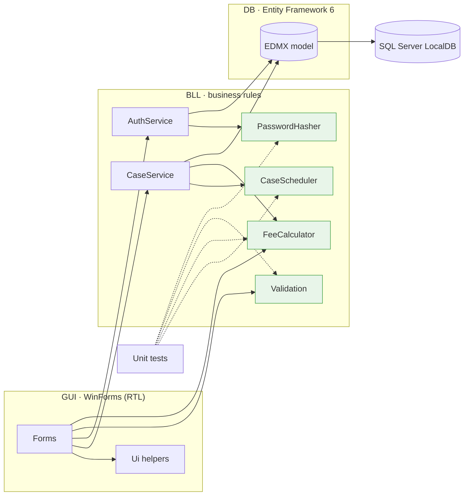
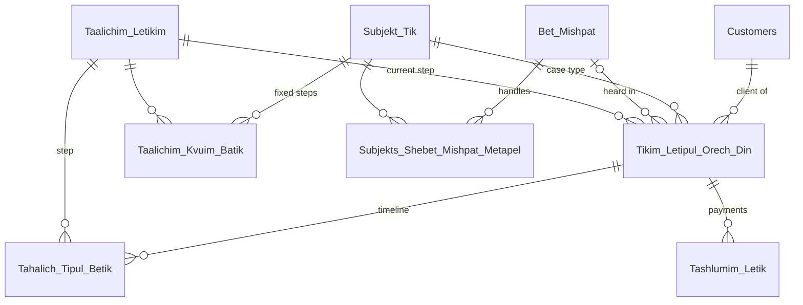

<div align="center">

# QUEDIN ⚖️
### Case & deadline management for a law office

[](https://github.com/shirushit/quedin-law-office-manager/actions/workflows/build.yml)

-blue)


**English** · [עברית](#עברית)

</div>

QUEDIN is a Hebrew desktop application that runs the day-to-day work of a law office:
clients and opposing parties, court cases and property deals, fees and payments, receipts —
and, at its core, **a timeline engine that plans every case and keeps its deadlines up to date**.

It started as my high-school final project (2024), built with a real law office as the client.
**v1.1** is a full review and refactor of that project: I fixed the bugs, secured the data,
extracted the business rules into a tested layer and made the project runnable from a clean clone.
**v1.2** fixes everything found in a usability test and an edge-case code review: a "what's urgent
today" home screen, court-set dates, payment cancellation by credit note, an audit log, optimistic
concurrency and strict money parsing. See [CHANGELOG.md](CHANGELOG.md) for everything that changed.

---

## ✨ Features

| | |
|---|---|
| 📅 **Automatic case timeline** | Opening a case creates its steps from the case type (e.g. *filing → defence → pre-trial → evidence → ruling*), each with an estimated date. |
| 🔁 **Deadlines that move** | Completing a step (on the real date), or setting a date decided by the court, pushes every later step. Deadlines never fall on Friday/Saturday. Steps cannot be skipped; a manager can undo the last one. |
| 🚦 **"What's urgent today"** | The home screen lists the next step of every open case that is late or due this week. The cases list shows days late, with free search and a colour legend. |
| 💰 **Fees, balances, receipts** | Fee = agreed % of the claim (or property value) + court fee. The balance is always computed from the payments. Receipts store the VAT rate of the day; court fees carry no VAT. A payment is cancelled with a credit note, never deleted. |
| 🧾 **Audit log & backup** | Every payment, cancellation, step change and user change is logged with user and time. Managers can back up the database from the home screen. |
| 🤝 **Concurrent users** | Two people editing the same case: the second save is refused (optimistic concurrency with `rowversion`) and the case reloads, instead of silently overwriting. |
| 🏛️ **Court cases & property deals** | Court, claim and award amounts for litigation; address and land-registry numbers (gush/chelka) for real-estate deals. |
| 👥 **Roles** | Managers configure courts, case types, processes and users; regular users work on clients, cases and payments. |
| 🔒 **Security** | Salted PBKDF2-SHA256 password hashes; card payments keep only the last 4 digits. |

## 🧠 How the timeline engine works

Each case type has an ordered list of fixed steps, and each step has a typical duration:

```text
Civil claim:   1. Intake meeting (7d) → 2. Collect evidence (14d) → 3. File claim (21d) → 4. Await defence (30d) → ...
```

```text
Case opened Mon 04/03          Step 1 done LATE on Thu 14/03       Step 1 done EARLY on Wed 06/03
1. Intake        Mon 11/03     1. Intake        ✔ 14/03            1. Intake        ✔ 06/03
2. Evidence      Mon 25/03     2. Evidence        Thu 28/03 (+3d)  2. Evidence        Wed 20/03 (−5d)
3. File claim    Mon 15/04     3. File claim      Thu 18/04 (+3d)  3. File claim      Wed 10/04 (−5d)
```

A date that lands on Friday or Saturday moves to Sunday. When the court sets a hearing date, the
step keeps that exact date and the following steps are counted from it. Each step stores the
duration it had when the case was opened, so editing the catalogue later does not move old cases.

The rule lives in [`CaseScheduler`](LawyerProject/BLL/CaseScheduler.cs): a pure class with no UI or
database access, covered by [unit tests](tests/Quedin.Tests/CaseSchedulerTests.cs).
[`CaseService`](LawyerProject/BLL/CaseService.cs) maps it to the Entity Framework model.

## 🏗️ Architecture



Green classes are pure and unit-tested; the forms only collect input and show results.

## 🗃️ Data model



| Table | Meaning |
|---|---|
| `Customers` | Clients, opposing parties and opposing lawyers (`SugPerson`) |
| `Tikim_Letipul_Orech_Din` | Cases (court cases and property deals) |
| `Subjekt_Tik` | Case types, with fee and court fee |
| `Taalichim_Letikim` | Catalogue of processes and their typical duration |
| `Taalichim_Kvuim_Batik` | Ordered fixed steps of each case type |
| `Tahalich_Tipul_Betik` | The timeline of a specific case (estimated / done dates) |
| `Tashlumim_Letik` | Payments and the balance after each one |
| `Bet_Mishpat`, `Subjekts_Shebet_Mishpat_Metapel` | Courts and the case types each one handles |
| `Users` | Users, roles and password hashes |

## 🚀 Getting started

**Requirements:** Windows · Visual Studio 2022 with the *.NET desktop development* workload
(it includes SQL Server Express LocalDB).

```powershell
git clone https://github.com/shirushit/quedin-law-office-manager.git
cd quedin-law-office-manager

# create the database with demo data
sqlcmd -S "(localdb)\MSSQLLocalDB" -i database\create-database.sql
```

Then open `LawyerProject.sln` and press **F5** (NuGet restores Entity Framework automatically).

| User | Password | Role |
|---|---|---|
| `admin` | `Quedin2024` | Manager |
| `worker` | `Worker2024` | Regular user |

> No `sqlcmd`? In Visual Studio open **View → SQL Server Object Explorer**, connect to
> `(localdb)\MSSQLLocalDB`, open `database/create-database.sql` and run it.

The demo data is fictional. Its deadlines are relative to the day you run the script,
so some steps show as late and some as due soon right away.

## 🧪 Tests

| Suite | What it covers | Runs |
|---|---|---|
| [`Quedin.Tests`](tests/Quedin.Tests) — 104 unit tests | Timeline engine (weekends, reschedule, undo, completion-date rules), fee/VAT/balance math, password hashing, validation (ID / company / passport, Israeli and international phones, strict money parsing) | anywhere: `dotnet test tests/Quedin.Tests` |
| [`Quedin.IntegrationTests`](tests/Quedin.IntegrationTests) — 15 tests | The real data layer against QuedinDB: login and legacy-password upgrade, users, opening a case, completing/rescheduling/undoing steps, payments and cancellations, concurrent edits, case deletion | Windows + LocalDB, after running the database script. Each test is rolled back. |
| CI `database` job | Runs `create-database.sql` twice on SQL Server 2022 and verifies the demo data | every push |

In Visual Studio: **Test → Run All Tests**. Without the database, the integration tests are
reported as *inconclusive* instead of failing.

## 📁 Project structure

```text
LawyerProject/
├── BLL/          business rules (CaseScheduler, FeeCalculator, Validation, PasswordHasher, services)
├── DB/           Entity Framework 6 model (EDMX) and entity partial classes
├── GUI/          WinForms screens (Hebrew, right-to-left)
└── App.config    connection string, VAT rate, "due soon" window
database/         create-database.sql: schema + demo data
tests/            unit tests (.NET 8) and integration tests (.NET Framework + LocalDB)
docs/             diagrams from the original project book
```

## 📐 Original design documents

| Use case | Context diagram |
|---|---|
|  |  |

## 🗺️ Roadmap

- **v2.0:** ASP.NET Core Web API + React, EF Core migrations, JWT roles, Docker Compose
- English naming across the domain model (`Case`, `Client`, `Payment`, …)
- Deadline reminders by e-mail
- Israeli public holidays in the deadline calendar (today only Friday/Saturday are skipped)
- Document attachments per case

---

<div dir="rtl">

## עברית

**QUEDIN** היא מערכת לניהול משרד עורכי דין: לקוחות, תיקים בבית משפט ועסקאות נכסים, שכר טרחה, תשלומים וקבלות.
הלב שלה הוא **מנוע תזמון** שבונה לכל תיק את רשימת השלבים לפי נושא התיק, ומעדכן אוטומטית את המועדים של כל השלבים הבאים כשמסמנים שלב כבוצע.

הפרויקט נכתב כפרויקט גמר בתיכון (2024) עבור משרד עורכי דין אמיתי.
גרסה 1.1 היא בדיקה ושכתוב של הפרויקט: תיקון באגים, אבטחת סיסמאות ונתוני תשלום, שכבת לוגיקה נפרדת עם בדיקות יחידה, וסקריפט שמקים את מסד הנתונים עם נתוני דמה.
גרסה 1.2 מתקנת את כל הממצאים מבדיקת שימושיות ומסקירת קוד: מסך "מה דחוף היום", מועדים שנקבעו בבית המשפט, ביטול תשלום בקבלת זיכוי, יומן פעולות, הגנה מעריכה מקבילה ופענוח סכומים קפדני.

**הרצה:** להריץ את `database/create-database.sql`, לפתוח את `LawyerProject.sln` ב-Visual Studio 2022 וללחוץ F5.
כניסה עם `admin` / `Quedin2024`.

</div>

---

Built by **Shira Toledano** · [github.com/shirushit](https://github.com/shirushit) · Licensed under the [MIT License](LICENSE)
